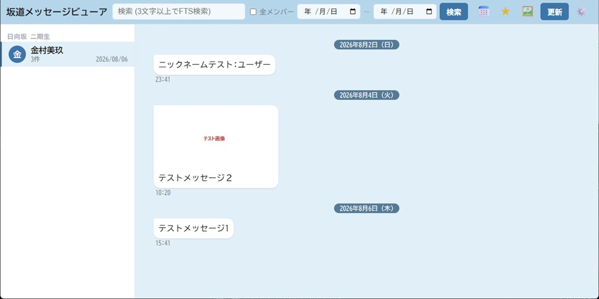

# 坂道メッセージビューア

colmsgを使用して時系列で蓄積されたメッセージ・画像・動画・音声ファイル群を、チャットアプリ風のWeb UIで閲覧・検索できるツール。
メッセージ保存フォルダ（読み取り専用）を走査してSQLiteインデックスを構築し、バックエンドがWeb UIに配信する。バックエンドはRust製（`message-viewer.exe`。exe単体で動く）。
保存フォルダの指定は初回起動時にWeb UI（設定アイコン &#9881;）から行う。`config.json` を直接編集する必要はない。



## 主な機能

- サイドバーによるメンバー（スレッド）一覧・切り替え（「表示設定」から個別に非表示にでき、ドラッグ&ドロップで並び順も変更できる）
- 仮想スクロールによる大量メッセージの高速表示
- SQLite FTS5による全文検索（空白区切りのAND検索、`"..."` でフレーズ、`-語` で除外。ヒット総数の表示と「さらに読み込む」による続きの取得に対応）
- 検索結果は該当箇所周辺を抜粋して検索語をハイライト表示
- 検索結果から本文へジャンプしたとき、タイムライン上でも検索語をハイライト表示
- カレンダーからの日付ジャンプ
- 画像・動画・音声のインライン表示（動画はRange対応でシーク再生可能）
- メディアギャラリー（メンバー別、画像/動画/音声・日付範囲で絞り込み）
- お気に入り登録（メンバー横断/個別の一覧表示に対応）
- メッセージへのコメント（自由記述、1000文字まで。お気に入り登録の有無を問わずタイムライン上に常時表示）
- ライト/ダークのテーマ切り替え
- インデックス取り込み中の進捗バー表示
- 差分取り込み（ヘッダの「更新」）と、全期間の取り込み直し（設定→「取り込み」タブ。全メンバー／メンバー個別を選択可）
- メンバー単位の削除（設定→「初期化」タブ。メッセージ・サムネイル・お気に入り・コメントをDBから削除。保存フォルダ側のファイルは削除しないため、同名メンバーが残っていれば次回取り込みで復活する）

## ダウンロード（ビルド不要）

[Releases](https://github.com/tk826/saka-message-viewer/releases) から `saka-message-viewer-<版>-windows-x64.zip` をダウンロードして展開し、`message-viewer.exe` をダブルクリックする。ブラウザで `http://localhost:8000/` を開くと使える（Windows 64bit。インストール不要）。使い方は zip の中の `README.txt` を参照。

## 動作要件

- Windows 64bit。配布版の `message-viewer.exe` は単体で動く（SQLite・Visual C++ ランタイムは同梱）
- 自分でビルドする場合は Rust（rustup）と Visual Studio Build Tools（C++）が必要
- ffmpegは任意（動画サムネイル生成用）。無くても機能上の問題はない。詳細は [docs/ffmpeg.md](docs/ffmpeg.md) を参照

## セットアップ（ソースからビルドする場合）

事前に Rust と Visual Studio Build Tools のインストールが必要。詳細は [docs/setup.md](docs/setup.md) を参照。

メッセージ保存フォルダは `{メンバー}/{YYYY}/{YYYYMM}/{file}` の階層でも、`{メンバー}/{file}` のようにメンバー直下にファイルを置いた形でも取り込める（いずれも `{グループ}/` を挟んだ形に対応）。ファイル数が多い場合は `MoveFiles.bat` で階層に整形しておくと差分取り込みが速くなる（任意。取り込み済みのフォルダを整形した場合は、設定 &#9881; →「取り込み」タブから全期間を取り込み直す）。

```powershell
cd \message-viewer
.\build_rust.bat      # message-viewer.exe をビルドしてプロジェクト直下に置く（ソース更新のたびに再実行）
```

ビルドしたら `message-viewer.exe` をダブルクリックしてサーバを起動し、ブラウザで `http://localhost:8000/` を開く。ログは `data\server_log.txt` にも残る。

## バッチファイル一覧（Windows運用）

| コマンド | 説明 |
| --- | --- |
| `build_rust.bat` | サーバ（`message-viewer.exe`）のビルド。プロジェクト直下にコピーする |
| `MoveFiles.bat "C:\messages"` | 日付付きフォルダの統合 + 保存フォルダを `{YYYY}/{YYYYMM}/` 階層に整形（任意） |

取り込み（全期間・メンバー個別・未生成サムネイルの作成）は設定 &#9881; →「取り込み」タブから実行する。サーバの起動の詳細（ログ、二重起動の検知など）は [docs/batch-files.md](docs/batch-files.md) を参照。

## 設定

保存フォルダ（`root`）が未設定なら、ブラウザで開いたときに設定ダイアログが自動表示される（設定アイコン &#9881; からいつでも変更可）。指定すると `config.json` に保存され、直後にバックグラウンドで取り込みが開始される。

`config.json` を直接編集することも可能（相対パスは `config.json` のあるディレクトリ基準）。

## 詳細ドキュメント

- [docs/cli.md](docs/cli.md) — CLI直接実行によるサーバ起動・インデックス構築、テスト
- [docs/api.md](docs/api.md) — APIエンドポイント一覧
- [docs/data-format.md](docs/data-format.md) — データ仕様
- [docs/api-spec.md](docs/api-spec.md) — APIとインデクサの細部の仕様
- [docs/release.md](docs/release.md) — リリース（GitHub Releases での実行ファイルの配布）の手順

## ライセンス

[MIT License](LICENSE)
